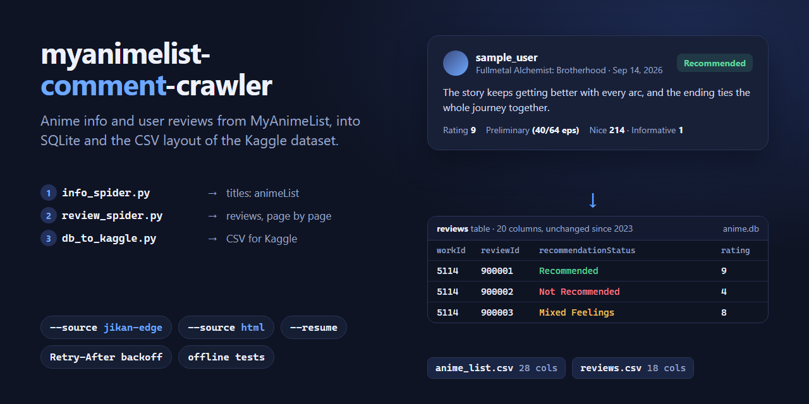
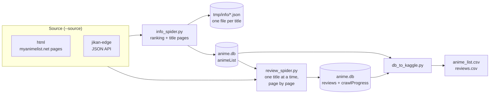

<div align="center">



# myanimelist-comment-crawler

[](https://github.com/NatLee/myanimelist-comment-crawler/actions/workflows/ci.yml)

[](LICENSE)
[](https://www.kaggle.com/datasets/natlee/myanimelist-comment-dataset-v2)

</div>

Collect anime information and every user review from [MyAnimeList](https://myanimelist.net) (MAL) into a
SQLite database, then export it as the two CSV files of the
[MyAnimeList comment dataset on Kaggle](https://www.kaggle.com/datasets/natlee/myanimelist-comment-dataset).
It is built on [Scrapy](https://scrapy.org), crawls one request at a time, waits when a server asks it to,
picks up where it stopped, and can read either MAL's web pages or a Jikan-style JSON API, with the same
tables and columns either way.

## Does it still work? (checked 2026-11-04)

| How you run it | Status | Why |
|---|---|---|
| `--source jikan-edge` | **Works** | Anime info, the ranking and reviews all come through [Jikan-Edge](https://jikan.lucashdo.com), an open-source API over public MAL data. |
| `--source html` (the default, as in 2023) | **Stops at the first request** | MAL's [robots.txt](https://myanimelist.net/robots.txt) now lists `Scrapy` under `Disallow: /`. The crawler respects that and tells you to switch sources. The page parsers themselves still match MAL's pages of 2026-11-04 (see `tests/fixtures/html`). |
| The 2023 code, freshly installed | **Did nothing** | Scrapy 2.16 (May 2026) stopped calling `start_requests()`, so both spiders exited silently. Fixed here. |
| Jikan v4 (`api.jikan.moe`) | **Gone** | The public Jikan API [shut down on 2026-10-01](https://github.com/jikan-me/jikan-rest/issues/613); Jikan-Edge is one of the replacements its maintainer suggests. |

### Before you crawl

MyAnimeList's [terms of use](https://myanimelist.net/about/terms_of_use) (4E, updated 2026-10-16) limit automated
access to what a person could do with a browser and ask users not to aggregate site content for use elsewhere
or collect profile names. Review texts and usernames belong to the people who wrote them. Crawl slowly, keep
what you collect for research, and think twice before republishing usernames or full texts.

Jikan-Edge's public instance allows 60 requests a minute. The `jikan-edge` source uses 30 a minute and
waits whenever the API answers `429 Too Many Requests`. For a full crawl (tens of thousands of requests), run
[your own Jikan-Edge instance](https://github.com/LucasHenriqueDiniz/jikan-edge) and set its address in
`setting.ini`.

## How it works



1. `info_spider.py` walks the all-time ranking (or only the IDs you give it) and saves every title to the
   `animeList` table and to `tmp/info/<id>.json`. Titles that already have a JSON file are skipped next time.
2. `review_spider.py` takes the titles from `animeList` and saves their reviews to `reviews`, page by page.
   It records each finished page in `crawlProgress`, so `--resume` can continue after a break.
3. `db_to_kaggle.py` writes `anime_list.csv` and `reviews.csv`, reviews sorted from oldest to newest.

## Install

Python 3.10 or newer.

```bash
git clone https://github.com/NatLee/myanimelist-comment-crawler.git
cd myanimelist-comment-crawler
pip install -r requirements.txt
```

## Quick start

These commands and outputs are from a real run on 2026-11-04.

```console
$ python info_spider.py --source jikan-edge --ids 5114,11979
23:44:58 INFO    info_spider: source jikan-edge (Jikan-Edge JSON API (community replacement for the retired public Jikan API)), database anime.db
23:45:00 INFO    [1] saved 5114 Fullmetal Alchemist: Brotherhood
23:45:01 INFO    [2] saved 11979 Puella Magi Madoka Magica the Movie Part 2: Eternal
23:45:01 INFO    info_spider finished (finished): 2 saved, 0 already saved, 0 failed

$ python review_spider.py --source jikan-edge --ids 11979
23:45:02 INFO    review_spider: source jikan-edge (Jikan-Edge JSON API (community replacement for the retired public Jikan API)), database anime.db
23:45:03 INFO    [1/1] 11979 Mahou_Shoujo_Madoka%E2%98%86Magica_Movie_2__Eien_no_Monogatari: page 1, 20 reviews
23:45:05 INFO    [1/1] 11979 Mahou_Shoujo_Madoka%E2%98%86Magica_Movie_2__Eien_no_Monogatari: page 2, 1 reviews (last page)
23:45:05 INFO    review_spider finished (finished): 21 reviews saved from 1 of 1 titles, 0 failed requests

$ python db_to_kaggle.py
23:45:06 INFO    wrote anime_list.csv
23:45:06 INFO    wrote reviews.csv
```

The default HTML source, today:

```console
$ python info_spider.py --ids 11979
23:45:23 INFO    info_spider: source html (MyAnimeList web pages (original method; MAL's robots.txt currently blocks it)), database anime.db
23:45:24 ERROR   Stopping: Scrapy refused to send https://myanimelist.net/anime/11979 (Forbidden by robots.txt). The site's robots.txt does not allow this crawler there. Try another source, e.g. --source jikan-edge (see README).
23:45:24 INFO    info_spider finished (request_refused): 0 saved, 0 already saved, 0 failed
```

Leave out `--ids` to crawl everything: the whole ranking for `info_spider.py`, every saved title for
`review_spider.py`. At the default pace that is many hours; stop with Ctrl+C at any time and continue with
`python review_spider.py --source jikan-edge --resume`.

## Usage

```text
python info_spider.py   [--source {html,jikan-edge}] [--ids ID,ID] [--delay SECONDS] [--config FILE] [-v]
python review_spider.py [--source {html,jikan-edge}] [--ids ID,ID] [--resume] [--delay SECONDS] [--config FILE] [-v]
python db_to_kaggle.py  [--config FILE] [--out-dir DIR]
```

| Option | Default | What it does |
|---|---|---|
| `--source` | `html` | Where to read from: MAL's web pages or the Jikan-Edge API. |
| `--ids` | everything | Only these MAL IDs, comma-separated (the number in `myanimelist.net/anime/5114/...`). |
| `--resume` | off | Reviews: skip titles finished earlier, restart unfinished ones at their last saved page. |
| `--delay` | per source | Seconds between requests. Defaults: html 7 (info) / 4 (reviews), jikan-edge 2. |
| `--config` | `setting.ini` | Settings file to use. |
| `-v`, `--verbose` | off | Also print Scrapy's own log. |

`--help` on each script prints the same. The 2023 commands still work, with spider arguments in place of
the options:

```bash
scrapy runspider info_spider.py --nolog -a source=jikan-edge -a ids=5114
scrapy runspider review_spider.py --nolog -a source=jikan-edge -a resume=1
```

When the crawl has to stop (robots.txt refuses it, there is nothing to crawl, five titles in a row fail),
the scripts say why and exit with status 1. A single title that fails is logged and skipped.

### Settings (`setting.ini`)

```ini
[SETTING]
RankIncrement = 50
[PATH]
TempWorkInfoFolder = tmp/info
[DATABASE]
DatabaseName = anime.db
[JIKAN_EDGE]
BaseUrl = https://jikan.lucashdo.com/v1
[MAL]
BaseUrl = https://myanimelist.net
```

`RankIncrement` is the number of titles per page of MAL's top anime list (html source). `TempWorkInfoFolder`
holds one JSON file per title. `[JIKAN_EDGE] BaseUrl` can point at your own instance. Settings files from
2023 (the first three sections only) still work; missing keys use these defaults.

## Output

The tables and CSV columns are the same as in 2023, so the Kaggle datasets and code written for them keep working.

- `animeList` / `anime_list.csv`: 28 columns. `workId`, `url`, Japanese, English and other names, type,
  episodes, status, aired, premiered, producers, broadcast, licensors, studios, genres, themes, demographic,
  source, duration, rating, score, rank, popularity, members, favorites, number of scorers, `lastUpdate`.
- `reviews` / `reviews.csv`: 20 columns in the database. The CSV leaves out the reviewer's profile and
  avatar links, which leaves 18. `workId`, `reviewId`, `workName`, `url`, `postTime`, `episodesSeen`
  (only for reviews written before finishing, e.g. `(40/64 eps)`), `overallRating`, `author`, `review`,
  `recommendationStatus`, and the seven reaction counts `nice`, `loveIt`, `funny`, `confusing`,
  `informative`, `wellWritten`, `creative`.
- `crawlProgress`: new in 2026, used by `--resume`; not exported.

One title, as saved in `tmp/info/011979.json` (some of its 27 fields):

```json
{
    "workId": "11979",
    "url": "https://myanimelist.net/anime/11979/Mahou_Shoujo_Madoka%E2%98%86Magica_Movie_2__Eien_no_Monogatari",
    "jpName": "劇場版 魔法少女まどか☆マギカ 永遠の物語",
    "engName": "Puella Magi Madoka Magica the Movie Part 2: Eternal",
    "synonymsName": "Mahou Shoujo Madoka Magika Movie 2, Magical Girl Madoka Magica Movie 2",
    "workType": "Movie",
    "episodes": "1",
    "status": "Finished Airing",
    "aired": "Oct 13, 2012",
    "genres": "Drama, Suspense",
    "themes": "Mahou Shoujo, Psychological",
    "source": "Original",
    "duration": "1 hr. 51 min.",
    "rating": "PG-13 - Teens 13 or older",
    "score": "8.38"
}
```

### Same columns, two sources

Both sources write numbers the way MAL's pages show them (`#2`, `3,752,360`, `9.10`). On 2026-11-04 the two
gave identical anime rows for the test titles except for the URL. The differences that remain:

| | `html` | `jikan-edge` |
|---|---|---|
| `reviews.url` | the reviews page the review was on (as in the 2023 data) | the review's own link, `reviews.php?id=...` |
| Review order | newest first | MAL's default order |
| Title URL / `workName` | as linked from the ranking | as the API returns it (one title spells ★ as ☆) |
| robots.txt | respected | not consulted; the API's rate limit is followed instead |

### Compared with the v2 dataset (2023)

Some 2023 bugs changed the data, not only the code. New crawls differ in these ways:

- `recommendationStatus` now also holds `Not Recommended` and `Mixed Feelings`. Before, they were empty.
- `source` is filled when MAL shows it as a link, e.g. `Manga`. Before, it was empty.
- Review text no longer has a stray `...` in the middle of a sentence (MAL's "Read more" button) or the
  page's indentation.
- `reviews.csv` is sorted by date. Before, it was sorted alphabetically by the date text, so April came before January.

## Development

```bash
pip install -r requirements-dev.txt
python -m pytest      # offline: a local fake site plays MAL and Jikan-Edge
ruff check .
```

The tests use small, anonymised copies of real pages and API answers from 2026-11-04 (`tests/fixtures`). CI
runs them on Python 3.10, 3.12 and 3.14, plus once with the oldest versions `requirements.txt` allows.

## Datasets

- [MALCoD](https://www.kaggle.com/datasets/natlee/myanimelist-comment-dataset), version 1: 130K reviews, 2006/11 to 2019/06.
- [MALCoDv2](https://www.kaggle.com/datasets/natlee/myanimelist-comment-dataset-v2), version 2: 220K reviews, 2006/11 to 2023/06.

## Tip: look at the data with VisiData

[VisiData](https://www.visidata.org/) shows SQLite databases and CSV files in the terminal
(`sudo apt install visidata`, then `vd anime.db`).


## Contributor

<!-- ALL-CONTRIBUTORS-LIST:START - Do not remove or modify this section -->
<!-- prettier-ignore-start -->
<!-- markdownlint-disable -->
<table>
  <tbody>
    <tr>
      <td align="center"><a href="https://github.com/NatLee"><br /><sub><b>Nat Lee</b></sub></a></td>
    </tr>
  </tbody>
</table>

<!-- markdownlint-restore -->
<!-- prettier-ignore-end -->

<!-- ALL-CONTRIBUTORS-LIST:END -->

## License

[MIT](LICENSE)
